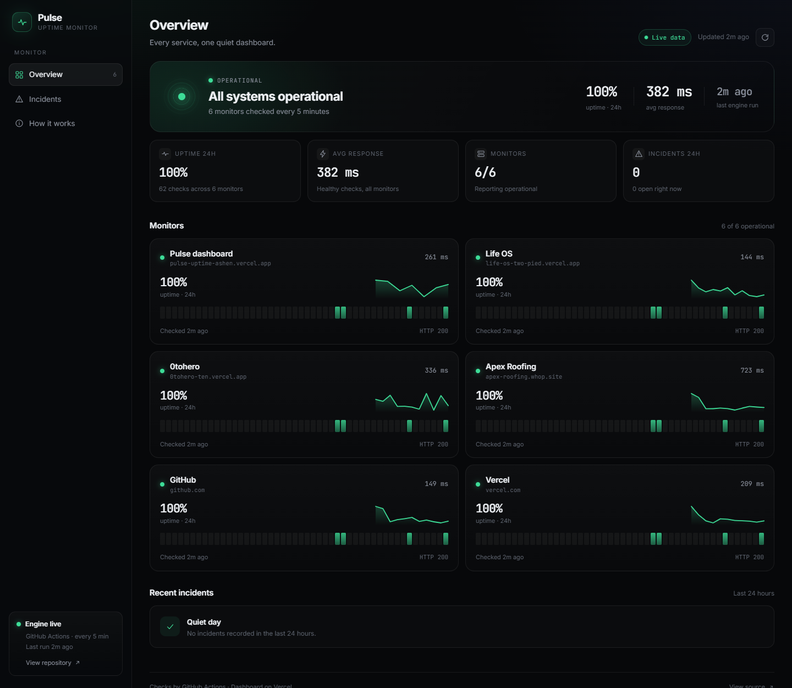
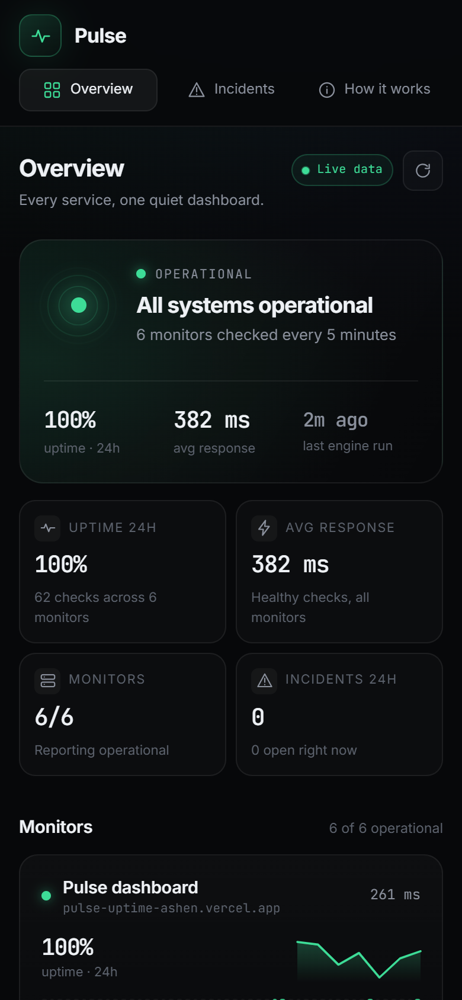

<div align="center">
  
  <h1>Pulse</h1>
  <p><strong>Uptime monitoring without the ceremony.</strong></p>
  <p>A zero-database uptime monitor. Checks run on GitHub Actions,<br />history lives on a data branch, and the dashboard is a static React app on Vercel.</p>

  <p>
    <a href="https://pulse-uptime-ashen.vercel.app"><strong>Live demo</strong></a>
    &nbsp;·&nbsp;
    <a href="#how-it-works">How it works</a>
    &nbsp;·&nbsp;
    <a href="#add-a-monitor">Add a monitor</a>
  </p>

  <p>
    <a href="https://github.com/KION6969/pulse-uptime/actions/workflows/ci.yml"></a>
    <a href="https://github.com/KION6969/pulse-uptime/actions/workflows/check.yml"></a>
    
    
  </p>
</div>



## What it does

Pulse watches a list of URLs and tells you, at a glance, whether they are up.

- **Real checks, not a mockup.** Every target is fetched over HTTP with a 15-second
  timeout, redirects followed, status code and latency recorded.
- **History that survives.** The last 24 hours of raw checks, 90 days of daily
  uptime aggregates, and a deduplicated incident log.
- **A dashboard worth looking at.** Response-time chart with hover values, uptime
  strips in 15-minute and 30-minute segments, per-monitor detail panels, and a
  dedicated incidents view.
- **No infrastructure.** No database, no cron service, no API keys and no
  environment variables. The repository is the whole backend.
- **Free to run.** A public repo gets unlimited GitHub Actions minutes, and the
  dashboard is a static Vercel deployment.
- **Tested.** The checker's merge, incident and rollup logic is covered by
  `node --test`, and CI builds the app on every push.

<details>
<summary><strong>See it on a phone</strong></summary>
<br />

</details>

## How it works

```
config/monitors.json
        │
        ▼
GitHub Actions ──► scripts/check.mjs ──► status.json
 (every 5 min)          │                     │
                        │                     │ force-push, one commit
                        │                     ▼
                        │              branch: data
                        │                     │
                        ▼                     ▼
                 run summary          React dashboard (Vercel)
                     in Actions        reads the raw JSON
```

1. **`config/monitors.json`** is the only configuration. Add a URL, push, done.
2. **`.github/workflows/check.yml`** runs every five minutes and executes
   `scripts/check.mjs` against every monitor in parallel.
3. The checker merges each result into the previous state: it appends to a
   288-check ring buffer (24 hours at five-minute checks), updates today's
   aggregate, opens an incident on the first failure and closes it on recovery.
4. The workflow force-pushes the resulting `status.json` to the `data` branch as
   a single orphan commit, so the branch never accumulates history.
5. The dashboard fetches
   [`data/status.json`](https://raw.githubusercontent.com/KION6969/pulse-uptime/data/status.json)
   and falls back to the snapshot bundled at build time if the branch is
   unreachable. That is why the page is never blank.

## Add a monitor

Append one object to `config/monitors.json`:

```json
[
  {
    "id": "my-app",
    "name": "My app",
    "url": "https://my-app.vercel.app",
    "group": "Apps"
  }
]
```

`id` must be unique and stable — that is how history is matched across runs.
An optional `"expect"` field accepts a status code or an array of codes when a
target intentionally returns something other than 2xx/3xx.

Commit and push. The next scheduled run picks it up within five minutes.

## Deploy your own

1. Fork this repository.
2. Edit `config/monitors.json` and put your own URLs in it.
3. Edit `src/config.ts` — `REPO_OWNER` and `REPO_NAME` should match your fork.
   That is where the dashboard reads the `data` branch from.
4. Import the repository into Vercel. It is a standard Vite app; no environment
   variables are required.
5. Open the **Actions** tab and run **Check uptime** once. It creates the `data`
   branch with the first snapshot.

The scheduled workflow is already in the repo. No secrets, tokens or paid
services are involved.

## Run it locally

```bash
git clone https://github.com/KION6969/pulse-uptime.git
cd pulse-uptime
npm install
npm run check     # checks every monitor, writes public/status.json
npm run dev       # http://localhost:5173
```

Useful scripts:

```bash
npm test          # unit tests for the checker logic
npm run build     # typecheck + production build
npm run check -- --config config/monitors.json --out public/status.json
```

## Project structure

```
config/monitors.json       monitors and optional expected status codes
scripts/check.mjs          HTTP checker + status.json writer
scripts/lib.mjs            pure merge / incident / uptime logic
scripts/check.test.mjs     node:test coverage for that logic
src/                       React dashboard (Vite + TypeScript)
  config.ts                repo owner/name used by the dashboard
  components/              overview, monitor cards, detail panel, charts
  lib/                     status loading and derived metrics
public/status.json         last snapshot, used as a fallback
.github/workflows/check.yml  the five-minute engine
.github/workflows/ci.yml     tests + build on every push
```

## Honest limits

- Five minutes is GitHub's minimum schedule, and the scheduler is best-effort:
  runs can be delayed under load, and a brand-new schedule can take up to a day
  to register. If it hasn't fired yet, run the workflow once by hand. The
  dashboard shows the last run time rather than pretending the data is always
  fresh.
- There is no email or SMS alerting yet. The roadmap is to open a GitHub issue
  automatically when a monitor transitions to down, which keeps the whole stack
  inside the repo.
- The `data` branch is public, so anyone can read the uptime history.
- A failed check does not fail the workflow — an outage is data, not a broken
  build.

## License

MIT © KION6969
